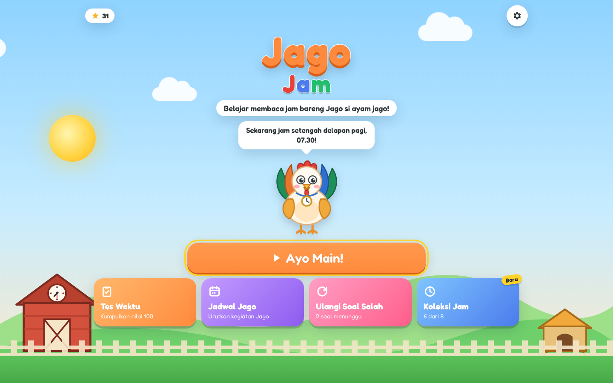
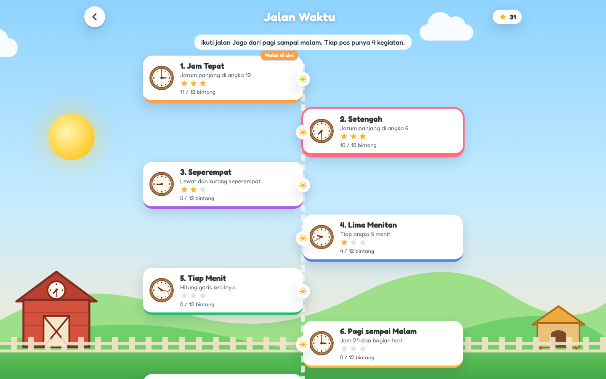
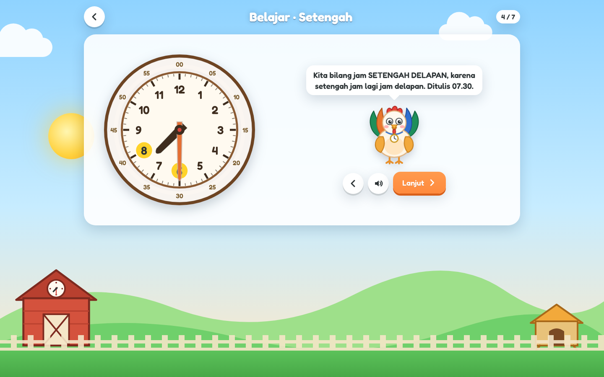
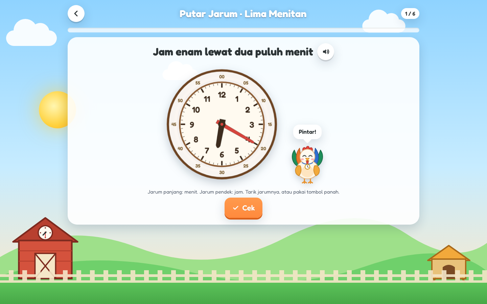
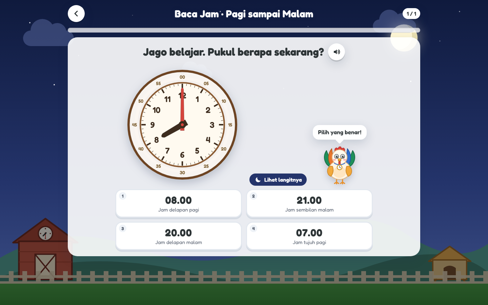
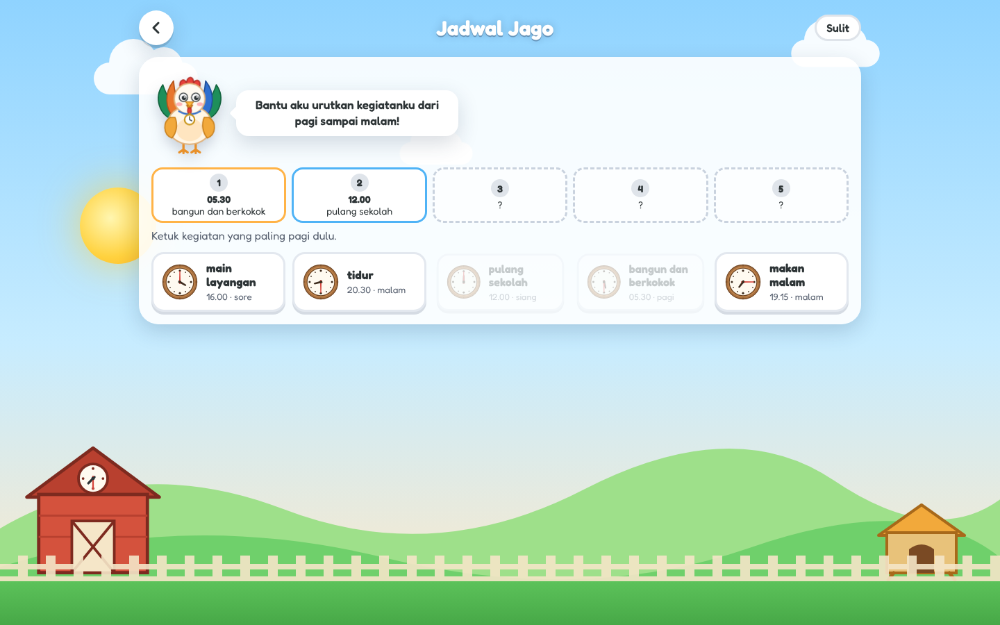
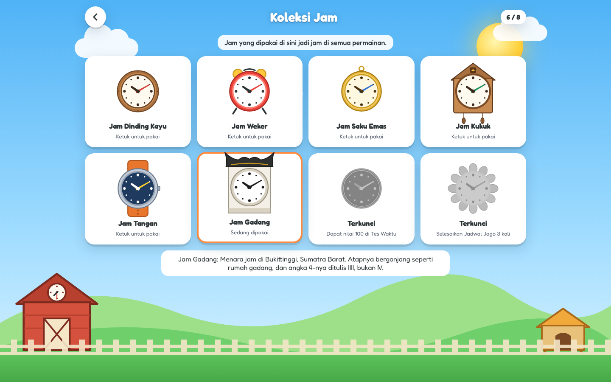
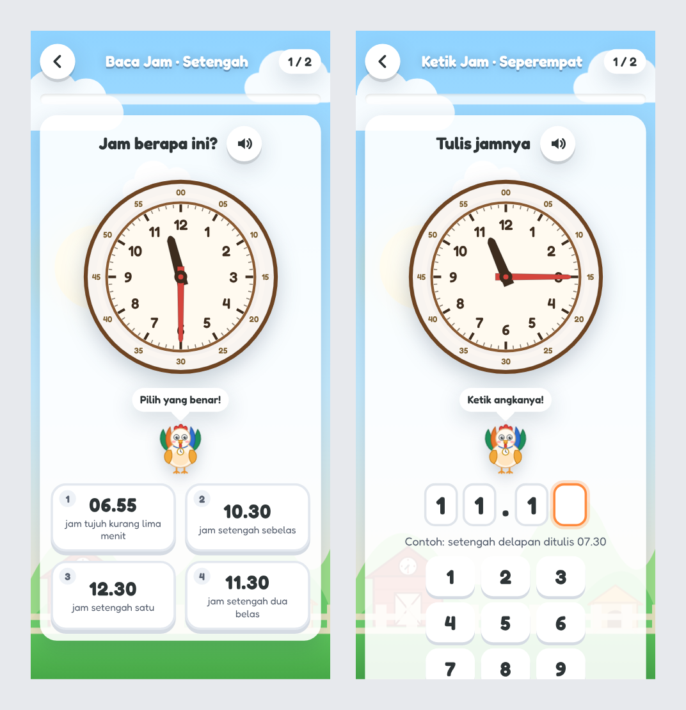

# Jago Jam

Game belajar membaca jam buat anak SD yang bisa langsung dimainkan di browser. Tokohnya Jago, ayam jago yang selalu bawa jam saku di lehernya. Jago ngajarin baca jam pelan-pelan, mulai dari jam tepat, setengah, seperempat, lima menitan, tiap menit, jam 24 sama pagi-siang-sore-malam, sampai ngitung lama waktu.

Bagian yang paling sering bikin bingung, kayak "setengah delapan" itu 07.30 (bukan 08.30), dijelasin langsung di jam yang jarumnya bisa diputar sendiri. Jamnya kerja kayak jam asli: kalau jarum panjang diputar satu putaran, jarum pendek ikut maju satu angka.

Gamenya statis, cuma pakai HTML, CSS, sama JavaScript biasa tanpa framework.

Link game: https://yahya-nz.github.io/Game-Jago-Jam/

## Tampilan

**Beranda**

Langit di beranda ikut jam sungguhan: pagi, siang, sore, atau malam. Jago juga nyebutin jam sekarang, dan jam di lumbung nunjukin waktu yang sebenarnya. Ketuk Jago buat dengar dia berkokok.



**Jalan Waktu**

Tujuh pos belajar dari pagi sampai malam. Tiap pos punya 4 kegiatan, dan bintangnya kelihatan langsung di petanya.



**Belajar**

Jago jelasin pelan-pelan sambil nunjuk jarum dan angka yang lagi dibahas. Di langkah terakhir, giliran kamu yang muter jarumnya.



**Putar Jarum**

Tarik jarum panjang ke waktu yang diminta. Jarum pendek ikut jalan sendiri, dan tiap menit kedengaran bunyi tik.



**Pagi sampai Malam**

Soal jam 24 dan bagian hari. Langitnya ikut berubah sesuai waktu di soal, jadi bisa dipakai buat nebak jawabannya.



**Jadwal Jago**

Urutkan kegiatan Jago dari pagi sampai malam. Di tingkat Sulit, kartunya cuma nunjukin jam jarum sama tanda matahari atau bulan.



**Koleksi Jam**

Bintang yang terkumpul membuka jam-jam baru, dari jam weker sampai Jam Gadang. Jam yang dipilih dipakai di semua permainan.



**Tampilan di HP**

Kiri: Baca Jam, pilih jawaban yang benar. Kanan: Ketik Jam, tulis jamnya pakai tombol angka di layar.



## Fitur

- Tujuh bab sesuai materi pengukuran waktu di SD: Jam Tepat, Setengah, Seperempat, Lima Menitan, Tiap Menit, Pagi sampai Malam (jam 24), dan Berapa Lama?.
- Empat kegiatan di tiap bab (Belajar, Baca Jam, Putar Jarum, Ketik Jam), masing-masing sampai 3 bintang.
- Pilihan jawaban yang salah sengaja diambil dari kesalahan yang sering terjadi, misalnya setengah delapan ketuker jadi 08.30, lewat sama kurang ketuker, atau jarum panjang kebaca sebagai jam.
- Jarum jam bisa ditarik, atau diputar pakai tombol panah. Jarum pendek ikut bergerak sesuai menitnya.
- Kalau dua kali salah, Jago nunjukin jawabannya di jam, terus lanjut ke soal berikutnya.
- Tes Waktu: pilih babnya sendiri, 10 atau 20 soal campur, nilainya 0 sampai 100. Nilai 10 tes terakhir disimpan dan ditampilin jadi grafik.
- Jadwal Jago: urutkan kegiatan sehari-hari, ada tingkat Sulit.
- Ulangi Soal Salah: soal yang pernah salah dikumpulin otomatis buat dilatih lagi.
- Koleksi 8 jam: Jam Dinding Kayu, Jam Weker, Jam Saku Emas, Jam Kukuk, Jam Tangan, Jam Gadang, Jam Neon, dan Jam Bunga.
- Langit ganti pagi, siang, sore, dan malam sesuai soalnya.
- Musik kalimba dengan detak tik-tok, bunyi tik waktu jarum diputar, kokok Jago, plus suara yang membacakan soal dalam bahasa Indonesia kalau perangkatnya punya.
- Bisa dimainkan di HP (tarik dan ketuk) maupun laptop (mouse dan keyboard).
- Kemajuan disimpan di browser.

## Teknologi

- HTML, CSS, dan JavaScript biasa.
- Jago, jam, dan semua bingkai jam koleksi digambar pakai SVG langsung di kode, nggak ada file gambar.
- Animasinya pakai CSS dan requestAnimationFrame.
- Musik dan efek suara dibikin langsung pakai Web Audio API, suara baca pakai Web Speech API.
- Font Fredoka dari Google Fonts.

## Struktur folder

```text
.
├── index.html             halaman game dan latar peternakan
├── assets
│   ├── css
│   │   └── style.css      tampilan, warna langit, dan animasi
│   └── js
│       ├── store.js       fungsi bantu, bahasa waktu, daftar bab, dan penyimpanan
│       ├── sound.js       musik, efek suara, kokok Jago, dan suara baca
│       ├── art.js         gambar SVG: Jago, bingkai jam koleksi, dan ikon
│       ├── clock.js       jam jarum yang bisa diputar
│       ├── ui.js          pindah layar, notifikasi, konfeti, dan balon kata Jago
│       ├── quiz.js        soal, Baca Jam, Putar Jarum, Ketik Jam, dan layar hasil
│       ├── screens.js     beranda, Jalan Waktu, halaman bab, dan Belajar
│       ├── extras.js      Tes Waktu, Jadwal Jago, Koleksi Jam, dan pengaturan
│       └── main.js        mulai game, tombol keyboard, dan jam di lumbung
└── screenshot
```

## Cara menjalankan

1. Clone atau download repo ini.
2. Buka file `index.html` di browser (Chrome, Firefox, Edge, atau Safari).
3. Pastikan konek internet, soalnya fontnya diambil dari Google Fonts. Kalau offline gamenya tetap jalan, cuma tulisannya pakai font bawaan browser.
4. Suaranya baru keluar setelah layar diketuk atau diklik. Musik, efek suara, suara baca, dan angka menit di pinggir jam bisa diatur lewat ikon gerigi di beranda.

## Cara main

| Aksi | Laptop | HP |
|---|---|---|
| Pilih jawaban di Baca Jam | Klik jawabannya, atau tombol `1` sampai `4` | Ketuk jawabannya |
| Putar jarum | Tarik jarumnya, atau klik jamnya lalu tanda panah (5 menit) dan `PageUp`/`PageDown` (1 jam) | Tarik jarumnya |
| Cek jawaban Putar Jarum | Tombol Cek, atau `Enter` | Tombol Cek |
| Ketik jam | Angka, `Backspace`, `Enter` | Tombol angka di layar |
| Ganti langkah di Belajar | Tanda panah kiri dan kanan | Tombol di layar |
| Kembali | `Esc` | Tombol panah di kiri atas |

## Mengubah isi

- Penjelasan tiap bab ada di `assets/js/screens.js`, bagian `LESSONS`.
- Jenis soal dan jawaban pengecohnya ada di `assets/js/quiz.js`, bagian `Q`.
- Kegiatan sehari-hari Jago (dipakai di bab Pagi sampai Malam, Berapa Lama?, dan Jadwal Jago) ada di `assets/js/quiz.js`, bagian `KEGIATAN`.
- Syarat membuka tiap jam koleksi ada di `assets/js/art.js`, bagian `CLOCK_RULES`.
- Batas pagi, siang, sore, dan malam ada di `assets/js/store.js`, fungsi `W.bagian`.
